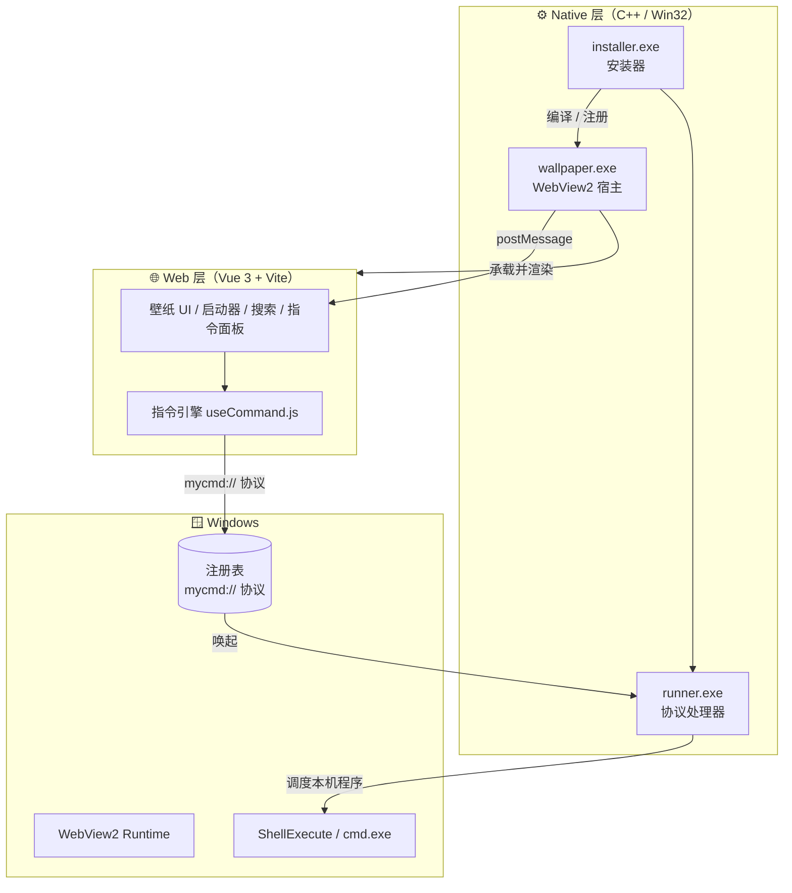
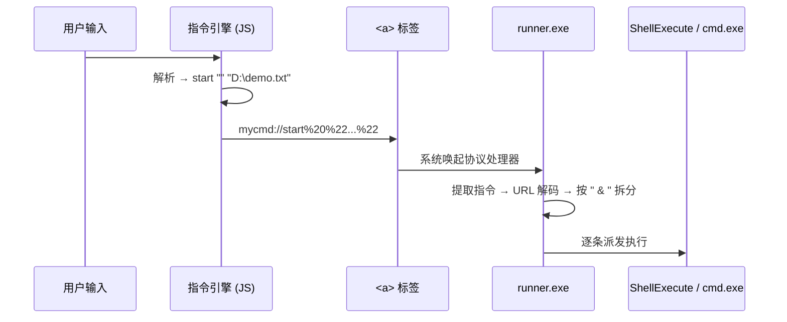

<div align="center">

# Web-Wallpaper

**用 Web 技术重构你的 Windows 桌面**

*面向智能体交互 · 基于 Web 技术与自定义通信协议的桌面控制系统*

[](https://www.microsoft.com/windows)
[](https://vuejs.org/)
[](https://vitejs.dev/)
[](https://isocpp.org/)
[](https://developer.microsoft.com/microsoft-edge/webview2/)
[](#-项目状态)

[特性](#-核心特性) · [架构](#-系统架构) · [原理](#-工作原理) · [快速开始](#-快速开始) · [指令](#-指令系统) · [路线图](#-路线图)

</div>

---

## 这是什么？

**Web-Wallpaper** 把整个 Windows 桌面变成一块可以任意渲染的 Web 画布。

它用 WebView2 承载一个 Vue 前端，再把这层前端以**半透明、可交互**的方式铺满整块屏幕——于是你熟悉的网页技术栈，直接变成了系统级的壁纸、启动器与命令行。

和"换张壁纸"不同，它的野心更大：**这是一套可编程的桌面外壳**。你可以在壁纸上放时钟、搜索、应用启动器，也能用 `#指令` 和 `$shell` 直接调度本机程序——一切由前端驱动，由一套自定义协议打通 Web 与系统之间的边界。

> [!NOTE]
> 本项目为个人实验性质，仍在积极开发中。

---

## ✨ 核心特性

| | 特性 | 说明 |
|---|---|---|
| 🖼️ | **多形态壁纸** | 图片 / 视频 / 透明三种模式，一键切换。视频壁纸数据存于 IndexedDB，透明模式直接透出真实桌面 |
| 🕐 | **桌面信息层** | 时钟、搜索框、应用启动器叠于壁纸之上，构成可交互的桌面信息面板 |
| 🚀 | **应用启动器** | 图标网格自由增删改，右键菜单即可编辑，配置持久化到本地 |
| 🔍 | **多引擎搜索** | 内置搜索引擎切换与搜索历史，输入即搜 |
| ⌨️ | **自定义指令** | `#` 指令、`$` shell、纯 URL 三种输入形态，像终端一样操作本机 |
| 🧩 | **指令编排** | 自定义指令集支持多行、可递归调用、参数占位符替换，用一行名字触发一串动作 |
| 🗂️ | **收藏 & 历史** | 书签收藏夹与浏览历史记录，桌面即浏览器 |
| 🔌 | **插件系统** | 可扩展的插件入口（🚧 开发中） |
| 🎛️ | **一键安装** | 图形化安装器自动完成环境检测、源码拉取、SDK 下载、编译与注册 |

---

## 🏗️ 系统架构

整个系统由 **一个 Web 前端 + 三个原生程序** 组成，各司其职，通过 Windows 的 WebView2 消息机制与自定义 URL 协议串联。



### 三大原生程序

| 程序 | 角色 | 关键实现 |
|---|---|---|
| **wallpaper.exe** | 桌面宿主 | 创建 `WS_EX_LAYERED` 分层置底窗口，内嵌 WebView2 渲染前端；托盘图标常驻，单实例互斥锁 |
| **runner.exe** | 协议处理器 | 注册为 `mycmd://` 协议的处理器，解析 URL 中的指令，拆分为多条后逐条派发执行 |
| **installer.exe** | 图形化安装器 | 检测 Node.js / g++ / WebView2 环境，拉取源码与 SDK，编译并对前端执行 `npm build`，写入注册表 |

---

## 🔬 工作原理

### 1. WebView2 承载前端

[wallpaper.cpp](file:///c:/Web-Wallpaper-main/wallpaper.cpp) 在屏幕底层创建一个全屏、半透明（Alpha ≈ 220）的窗口，把 WebView2 运行时挂载上去，加载前端页面：

```
创建分层窗口 → 初始化 WebView2 → Navigate(前端地址) → 前端铺满桌面
```

窗口使用 `WS_EX_LAYERED` 而非 `WS_EX_TRANSPARENT`，因此**既能看见桌面，又能接收点击**——这正是"可交互壁纸"的关键。

### 2. 双向通信

前端与宿主之间通过 WebView2 的 `postMessage` 通道通信。例如切换壁纸模式时，前端发送：

```js
window.chrome.webview.postMessage('wallpaper:transparent'); // 或 wallpaper:opaque
```

宿主在 `WebMessageHandler` 中接收并响应。

### 3. 从 Web 触达系统：自定义协议

浏览器沙箱无法直接执行系统命令。本项目用 **自定义 URL 协议** 打通这层边界——把命令编码进一个 `mycmd://` 链接，交给注册好的 `runner.exe` 执行。



前端触发协议的方式很巧妙：动态创建一个隐藏的 `<a>` 标签并 `click()`，浏览器会将其视作用户手势，从而正常唤起协议处理器。

### 4. 指令派发策略（runner.exe）

[runner.cpp](file:///c:/Web-Wallpaper-main/runner.cpp) 拿到指令后，根据前缀选择最稳妥的执行方式，**避免手动拼接 cmd 语法出错**：

- `start "" "path"` → 用 `ShellExecuteW` 打开（正确处理空格路径、文件关联、UAC）
- `run "path"` → 同上，直接启动可执行文件
- `cmd /k ...` → 原样透传到 `CreateProcess`，保持窗口常驻
- 其余（`del` / `copy` / `move` / `rename`）→ 交给 `cmd.exe /c` 执行，执行完自动退出

所有执行记录写入 `runner.log`，自动滚动保留最近 **100** 条。

---

## 🚀 快速开始

### 方式一：一键安装（推荐）

运行 `installer.exe`，按提示选择安装目录即可。安装器会自动完成：

```
[1/10] 创建安装目录
[2/10] 检测环境（Node.js / g++ / WebView2 Runtime）
[3/10] 下载源码（支持 GitHub 官方源 / ghproxy 镜像源）
[4/10] 解压源码
[5/10] 下载 WebView2 SDK（NuGet）
[6/10] 解压 SDK
[7/10] 编译 runner.exe
[8/10] 编译 wallpaper.exe
[9/10] 构建前端（npm install && npm run build）
[10/10] 写入注册表（mycmd:// 协议 + 可选开机启动）
```

**前置要求：** [Node.js](https://nodejs.org) · [MSYS2 / MinGW (g++)](https://www.msys2.org) · [WebView2 Runtime](https://developer.microsoft.com/microsoft-edge/webview2/)

### 方式二：手动开发

前端可脱离原生宿主独立开发调试：

```bash
cd web
npm install
npm run dev      # 开发服务器 http://localhost:5173
npm run build    # 产物输出到 dist/
```

编译原生程序（需已下载 WebView2 SDK 到 `sdk/WebView2`）：

```bash
# runner.exe —— 协议处理器
g++ -o runner.exe runner.cpp -lshell32 -mwindows -std=c++17

# wallpaper.exe —— WebView2 宿主
g++ -o wallpaper.exe wallpaper.cpp ^
    -I"./sdk/WebView2/build/native/include" ^
    -L"./sdk/WebView2/build/native/x64" ^
    "./sdk/WebView2/build/native/x64/WebView2Loader.dll.lib" ^
    -lshell32 -lole32 -luser32 -lgdi32 -lws2_32 -mwindows -std=c++17
```

### 注册协议（手动安装时）

修改 [registermycmd.reg](file:///c:/Web-Wallpaper-main/registermycmd.reg) 中的 `runner.exe` 路径为本机实际路径，双击导入即可将 `mycmd://` 协议指向 runner。

---

## ⌨️ 指令系统

在搜索框中输入，即可直接操作本机。指令引擎 [useCommand.js](file:///c:/Web-Wallpaper-main/web/src/composables/useCommand.js) 会识别三种输入形态：

| 前缀 | 类型 | 示例 | 行为 |
|---|---|---|---|
| `#` | 系统 / 自定义指令 | `#open "D:\demo.txt"` | 展开为系统命令，经协议执行 |
| `$` | Shell 命令 | `$ ipconfig` | 透传给 `cmd.exe` 执行 |
| *(无)* | URL | `github.com` | 用默认浏览器打开 |

### 内置系统指令

| 指令 | 说明 |
|---|---|
| `#open <路径>` | 打开文件或文件夹 |
| `#run <路径>` | 运行应用 |
| `#del <路径>` | 删除文件 |
| `#copy <源> <目标>` | 复制文件 |
| `#move <源> <目标>` | 移动文件 |
| `#rename <源> <目标>` | 重命名文件 |

指令模板定义于 [command.json](file:///c:/Web-Wallpaper-main/command.json)，使用 `{0}` `{1}` 占位参数、`{dir0}` 提取目录，无需改代码即可自定义。

### 自定义指令集

在「更多选项 → 自定义指令」中，你可以把**一串命令**打包成一个短名字：

```
名称：work
内容：#open "D:\projects"
      $ code .
      https://github.com
```

之后只需输入 `#work`，即可一次性打开项目目录、启动 VS Code、并打开浏览器。支持多行、递归调用与参数替换。

---

## 📁 项目结构

```
Web-Wallpaper/
├── wallpaper.cpp          # 🖼️ 壁纸宿主：WebView2 + 分层窗口
├── runner.cpp             # ⚙️ 协议处理器：解析并派发 mycmd:// 指令
├── installer.cpp          # 🎛️ 图形化安装器
├── command.json           # 📜 系统指令模板
├── registermycmd.reg      # 🔗 mycmd:// 协议注册表脚本
└── web/                   # 🌐 Vue 3 + Vite 前端
    ├── src/
    │   ├── App.vue                      # 主应用 / 壁纸渲染
    │   ├── components/                  # 时钟、搜索、启动器、右键菜单…
    │   └── composables/
    │       ├── useCommand.js            # 指令引擎（协议触发核心）
    │       ├── useGlobalState.js        # 全局状态（搜索历史等）
    │       ├── useSearch.js             # 搜索逻辑
    │       └── useTime.js               # 时钟逻辑
    └── public/command.json              # 前端使用的指令配置
```

---

## 🧰 技术栈

- **前端**：Vue 3 (`<script setup>`) · Vite 7 · IndexedDB（视频壁纸）· localStorage（配置持久化）
- **原生**：C++17 · Win32 API · WebView2 SDK · WinInet（安装器下载）
- **通信**：WebView2 `postMessage` · 自定义 URL 协议 `mycmd://`
- **构建**：Vite · g++ (MinGW)

---

## 🗺️ 路线图

- [x] WebView2 宿主与半透明分层窗口
- [x] `mycmd://` 自定义协议与指令派发
- [x] 图片 / 视频 / 透明多形态壁纸
- [x] 应用启动器、搜索、收藏、历史
- [x] 自定义指令集（多行 / 递归 / 参数替换）
- [x] 图形化一键安装器
- [ ] 插件系统
- [ ] 多显示器支持
- [ ] 壁纸在线市场

---

## ⚠️ 项目状态

- 本项目为**个人实验性项目**，正在开发中，接口与结构可能变动。
- 部分代码在 AI 协助下完成。
- 安装后**请勿移动安装目录**，否则协议注册路径将失效，需重新安装。
- 指令系统可执行本机命令，请在使用自定义指令时注意来源可信。

---

<div align="center">

**如果这个项目对你有启发，欢迎点一个 ⭐**

Made with ❤️ and Web tech on Windows

</div>
